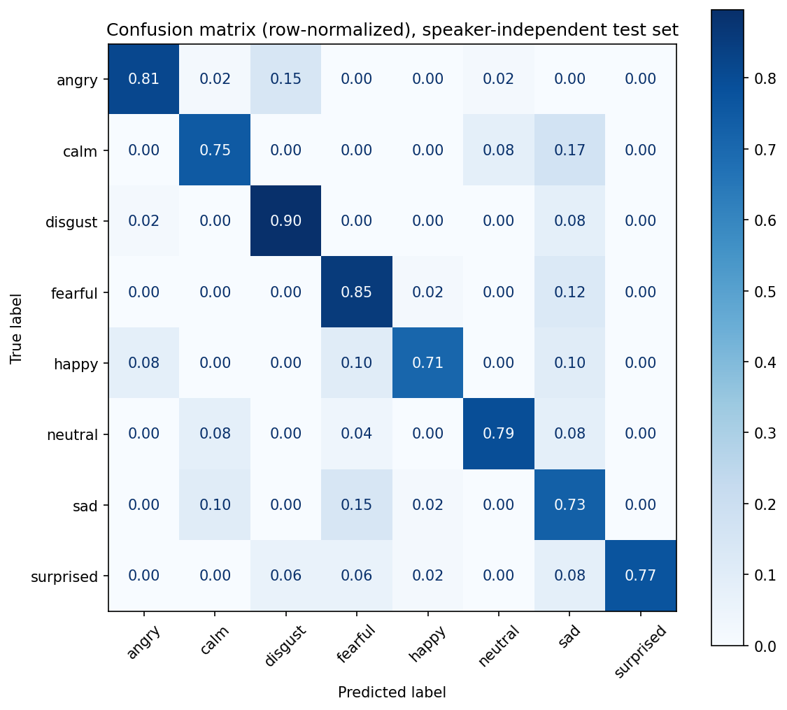

# Speech Emotion Recognition on RAVDESS

Classifies **8 emotions** (neutral, calm, happy, sad, angry, fearful, disgust, surprised) from short speech clips. The project compares:

1. **Handcrafted acoustic features** (pitch, intensity, MFCC, voice quality, spectral) with classical models
2. **Pretrained WavLM embeddings** with an SVC
3. **Fusion** of both (feature concatenation and probability averaging)

Every result uses a **speaker-independent split** (no actor appears in both train and test) and **per-actor feature normalization**.

---

## Results

Evaluated on 6 held-out actors (360 clips). Precision, recall and F1 are macro-averaged over the 8 classes.

| Model | Accuracy | F1 (macro) | Precision (macro) | Recall (macro) |
|---|---|---|---|---|
| Handcrafted · SVC | 0.564 | TODO | TODO | TODO |
| Handcrafted · MLP | 0.550 | TODO | TODO | TODO |
| Handcrafted · Stacking (MLP + SVC) | 0.569 | TODO | TODO | TODO |
| WavLM embeddings · SVC | 0.775 | TODO | TODO | TODO |
| Early fusion (handcrafted + WavLM) · SVC | 0.789 | TODO | TODO | TODO |

Full table: [`results/results_table.csv`](results/results_table.csv)



### Key findings
- Pretrained WavLM embeddings beat handcrafted features by about 21 points of accuracy (0.775 vs 0.564 for the single-model SVCs).
- Adding handcrafted features to the embeddings gives a small gain (0.789 vs 0.775). That is 5 more correct clips out of 360 and is **within noise** for a single 6-actor split, so I do not claim fusion helps.
- Per-actor normalization raised the handcrafted XGBoost baseline from 45.3% to 56.7% in an early experiment, mostly by removing speaker-specific baselines.

> **Caveat:** all numbers come from a single split with 6 test actors. Differences of 1-2 points are not reliable. Cross-validated results (GroupKFold over all 24 actors) would give a more stable estimate.

---

## Dataset

[RAVDESS](https://zenodo.org/records/1188976) (Ryerson Audio-Visual Database of Emotional Speech and Song), speech portion:

- 1,440 clips, 24 professional actors (12 male, 12 female)
- 8 emotions, 2 sentences, 2 intensity levels (no strong intensity for neutral), 2 repetitions
- Class balance: 192 clips for each emotion except neutral, which has 96
- Acted, not spontaneous, speech

The audio is **not included** in this repository. Download it from [Kaggle](https://www.kaggle.com/datasets/uwrfkaggler/ravdess-emotional-speech-audio) and set `ROOT` in the notebook to its location.

---

## Method

### 1. Speaker-independent split
`GroupShuffleSplit` on actor ID (75/25, `random_state=42`) puts every actor entirely in train or entirely in test. A random clip-level split would place the same voice and sentences in both sets and inflate scores, because the model can partly memorize speakers.

### 2. Handcrafted features (95 per clip)

| Group | Features | Count |
|---|---|---|
| Pitch | f0 mean, std, range, slope | 4 |
| Intensity | dB mean, std, range | 3 |
| Timbre | 30 MFCCs × (mean, std) | 60 |
| Energy and rate | RMS mean/std/max, duration, onset rate | 5 |
| Voice quality | jitter, shimmer, HNR, formants F1-F3 | 6 |
| Spectral | centroid mean/std, rolloff mean, spectral tilt | 4 |
| Timbre change | mean absolute delta of 13 MFCCs | 13 |

Pitch, intensity, jitter, shimmer, HNR and formants come from Praat (via `praat-parselmouth`); the rest come from `librosa`. Audio is loaded at 16 kHz and trimmed of leading and trailing silence.

### 3. Per-actor normalization
Each feature is z-scored within each actor (subtract the actor's own mean, divide by the actor's own standard deviation). This removes speaker baselines such as average pitch, loudness and formants. It uses only feature values from the actor's own clips and never the labels. In deployment it requires several clips from the same speaker.

### 4. WavLM embeddings
`microsoft/wavlm-base-plus` hidden states are mean-pooled over time for each of the 13 layers. **Layer 6** is used because middle layers tend to carry the most emotion information. Embeddings are normalized per actor in the same way and standardized with a scaler fitted on the training set.

### 5. Models
- **Handcrafted:** SVC (RBF), MLP (one hidden layer of 128 units, L2 penalty, early stopping), and a stacking classifier (MLP + SVC with an elastic-net logistic regression meta-model)
- **Embeddings:** SVC with balanced class weights
- **Early fusion:** one SVC on the 95 handcrafted features plus the 768 embedding dimensions
- **Late fusion:** weighted average of predicted probabilities (0.5 WavLM SVC, 0.25 handcrafted SVC, 0.25 MLP). Weights were fixed before evaluation, not tuned on the test set.

All scalers and encoders are fitted on the training set only.

---

## Repository structure

```
.
├── README.md
├── requirements.txt
├── emotion-classification-ravdess.ipynb   # full pipeline, run top to bottom
├── data/
│   ├── wavlm_layer6.npz                   # precomputed WavLM layer-6 embeddings (float16)
│   └── labels.csv                         # emotion, actor, filename, row-aligned with embeddings
└── results/
    ├── results_table.csv
    └── confusion_matrix.png
```

---

## How to run

```bash
git clone https://github.com/<your-username>/speech-emotion-recognition-ravdess.git
cd speech-emotion-recognition-ravdess
pip install -r requirements.txt
```

1. Download RAVDESS and set `ROOT` in the notebook to the dataset folder (it contains `Actor_01` ... `Actor_24`).
2. Open the notebook and run all cells.
3. WavLM embedding extraction is slow on CPU (20-30 minutes) and takes a few minutes on a GPU. To skip it, load the precomputed embeddings:

```python
d=np.load("data/wavlm_layer6.npz")
X_emb=pd.DataFrame(d["emb"].astype("float32"),index=d["index"]).add_prefix("emb_")
```

The first run downloads the WavLM weights (about 380 MB) from the Hugging Face Hub, so internet access is required. For a CPU-only setup, install the CPU build of PyTorch from pytorch.org before the other requirements.

### Predicting on your own recordings
The notebook includes a `predict_speaker(folder)` function that classifies a folder of `.wav` clips.

- Provide **at least 8 clips from the same speaker**, ideally with different emotions. Per-actor normalization needs several clips from one voice, and clips that are all the same emotion will wash out the differences.
- Predictions on non-acted, noisy or non-English speech are not validated and will likely be less accurate.

---

## Limitations
- **Acted speech:** RAVDESS actors read two fixed sentences with exaggerated emotion. Performance on natural speech is likely much lower.
- **Small test set:** 6 actors and 360 clips in a single split, so small score differences are within noise.
- **Normalization dependency:** per-actor normalization needs several clips per speaker at inference time.
- **Single dataset:** no cross-corpus evaluation (for example on TESS or CREMA-D) has been done.
- **North American English only**, 24 speakers, so results may not carry over to other languages, accents or ages.

## Possible next steps
- GroupKFold cross-validation over all 24 actors, reporting mean ± std
- Ablation by feature group (MFCC only, + prosody, + voice quality, + spectral)
- Layer-wise comparison of WavLM embeddings, and other pretrained models (wav2vec2, HuBERT)
- Cross-corpus testing on another emotion dataset

---

## References
- Livingstone, S. R., & Russo, F. A. (2018). The Ryerson Audio-Visual Database of Emotional Speech and Song (RAVDESS). *PLoS ONE* 13(5): e0196391.
- Chen, S. et al. (2022). WavLM: Large-Scale Self-Supervised Pre-Training for Full Stack Speech Processing. *IEEE Journal of Selected Topics in Signal Processing*.
- Boersma, P., & Weenink, D. Praat: doing phonetics by computer. Accessed through Parselmouth (Jadoul et al., 2018).

## License
Code: MIT (or your choice). The RAVDESS dataset is licensed separately under CC BY-NC-SA 4.0, so check its terms before reusing the data or the derived embeddings for commercial purposes.
